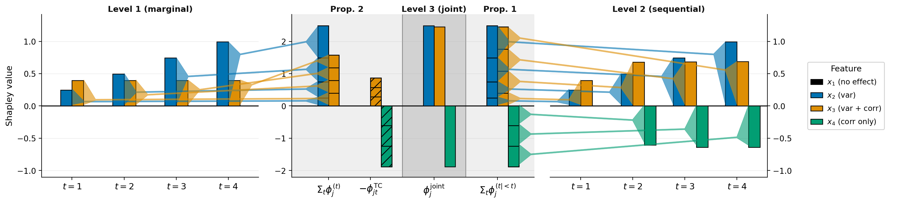
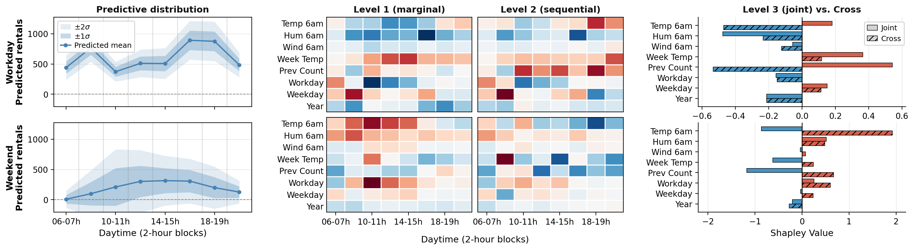

# A Hierarchy of Entropy-Shapley Games for Multivariate Predictive Uncertainty

Reproduction code for the NeurIPS 2026 paper *"A Hierarchy of Entropy-Shapley Games for
Multivariate Predictive Uncertainty"*.

<p align="center">
  
  <br/>
  <sub><b>Figure 1:</b> three entropy-Shapley games on a synthetic Gaussian DGP.
  <code>x₁</code> only drives the mean → zero attribution at every level;
  <code>x₄</code> only drives the cross-component correlation → invisible at
  Level 1 but dominant in the cross-component term.</sub>
</p>

## 🪜 The hierarchy in one glance

The paper introduces three entropy-based Shapley games that differ only in
how they treat dependencies between output components. For an ordered
multivariate output $\mathbf{Y} = (Y_1, \dots, Y_T)$, every game shares the
same construction: an inner (conditional) entropy term $h$, evaluated at the
completed input $\tilde{x} = (x_S, X_{\bar S})$ and averaged over the
out-of-coalition features,

$$
v(S, x) = \mathbb{E}_{X_{\bar S}}\big[ h\big(X = (x_S, X_{\bar S})\big) \big].
$$

By efficiency, the Shapley values of each game decompose the gap between the
local and the population-level term,
$\sum_{j=1}^p \phi(j, x) = h(X = x) - \mathbb{E}_X[h(X)]$.

| Level | Inner term $h(X = \tilde{x})$ | Captures |
|-------|-------------------------------|----------|
| L1/marginal   | $H(Y_t \mid X = \tilde{x})$              | marginal entropy at each output component $t$     |
| L2/sequential | $H(Y_t \mid Y_{<t}, X = \tilde{x})$      | sequential conditional entropy (chain-rule step)  |
| L3/joint      | $H(\mathbf{Y} \mid X = \tilde{x})$       | joint entropy over the full output vector         |
| Cross/TC      | $\mathrm{TC}(\mathbf{Y} \mid X = \tilde{x})$ | total correlation among output components     |

By construction **L3 = $\sum_t$ L2** (Proposition 1), and
**Cross/TC = $\sum_t$ L1 − L3** (Proposition 2), i.e., the cross-component
attribution recovers the deviation of the local total correlation from its
population average.

## 📦 Setup

```bash
uv sync
```

This pins NumPy 2.x / SciPy 1.14+ / PyTorch 2.5+ via `tool.uv.override-dependencies`.
CPU-only installs work as well (the notebooks fall back automatically) but
`5_main_comparison.py` needs a GPU for trajectory sampling. A single modern GPU
with ≥ 24 GB memory is sufficient for the full pipeline.

## 🔁 Reproducing the figures

Run the steps in order from `notebooks/`. Caches under `results/` and `models/` make
re-runs cheap; runtimes below are for cold first runs on one TITAN RTX with 24 CPU
workers (App. E). Set `QUICK_RUN=1` for a short test run with separate output folders.

- 🎯 **Figure 1:** *Synthetic Gaussian DGP (§5.1).*
  Run `notebooks/1_synthetic_dgp.ipynb` top-to-bottom (~2 min).

- 🚲 **Figure 2 + Figs D.2 / D.3:** *Bike Sharing NGBoost (§5.2 + App. D.2.1).*
  Run `notebooks/2_bikesharing_ngboost.ipynb` (~10 min).

- 🤖 **Prerequisite:** *DeepAR pre-training (used by Figures 3b and D.4).*
  Run `python 3_train_deepar.py` (<1 min if stored models are used; ~2 h retraining three likelihoods).
  → `models/deepar_{normal,studentt,lognormal}.ckpt`

- 🧪 **Figure 3a:** *Semi-synthetic benchmark (§5.3 + App. D.3.2).*
  Run `python 4_semisynthetic.py` (~40 min, CPU only).

- 📊 **Figure 3b:** *DeepAR vs. Chronos main comparison (§5.3).*
  Run `python 5_main_comparison.py` (~34 h; about 120 GB of RAM and 123 GB of disk for the trajectory caches). [Chronos-T5](https://huggingface.co/amazon/chronos-t5-base) is loaded from Hugging Face on first call.

- 🔬 **Figure D.4:** *DeepAR estimator validation (App. D.3.3).*
  Run `python 6_deepar_validation.py` (CPU-bound: ~24.5 h with `N_JOBS=200` on a 128-core server, about 6 days with 24 workers).

The result tables behind Figures 3a, 3b and D.4 are included, so `python make_figures.py`
(from the repository root) redraws these figures in seconds.

The core library lives in `entropy_shapley/`, including the hierarchy games (`game.py`), the imputer classes (`imputer.py`) and sample-based estimators (`estimators.py`). The Electricity pipeline (data, models, semi-synthetic ground truth, plotting) is in `experiments/`. 

## 📚 Datasets

* [**UCI Bike Sharing**](https://doi.org/10.24432/C5W894) (Fanaee-T, 2013): hourly rentals; aggregated into
  $T = 8$ two-hour blocks over 06:00–22:00. CC BY 4.0.
* [**UCI Electricity Load Diagrams 2011–2014**](https://doi.org/10.24432/C58C86) (Trindade, 2015; Xiong, 2024
  preprocessed snapshot from the package `gluonts`): hourly load per series; aggregated into $T = 12$ two-hour blocks per day, restricted to the first 100 series.
  CC BY 4.0.

Both files are bundled in `datasets/` for offline reproducibility.

## 🚲 A real-world example: Bike Sharing

What the hierarchy looks like on a real distributional regression model
(NGBoost with multivariate Gaussian output) for two contrasting forecast
origins of the UCI Bike Sharing dataset — a typical *workday* (top row, low
uncertainty, bimodal commute profile) versus a *weekend* (bottom row, high
uncertainty):

<p align="center">
  
  <br/>
  <sub><b>Figure 2:</b> left: predicted mean and uncertainty bands;
  centre: Level 1 (marginal) and Level 2 (sequential) attributions
  per feature × two-hour block; right: Level 3 (joint) and cross-component
  attributions. <code>Temp 6am</code> on the weekend instance is a good
  example: its joint contribution is negative (it *reduces* overall
  uncertainty), but its cross contribution is highly positive — i.e. it
  simultaneously tightens the dependence between rental blocks.</sub>
</p>

## 📝 Citation

If you use this code, please cite the paper ([OpenReview](https://openreview.net/forum?id=H5mUgkvpmE)):

```bibtex
@inproceedings{koenen2026hierarchy,
  title     = {A Hierarchy of Entropy-Shapley Games for Multivariate Predictive Uncertainty},
  author    = {Koenen, Niklas and Battistin, Claudia and Van den Abeele, Jeriek and Jullum, Martin},
  booktitle = {Advances in Neural Information Processing Systems},
  year      = {2026},
  url       = {https://openreview.net/forum?id=H5mUgkvpmE}
}
```
